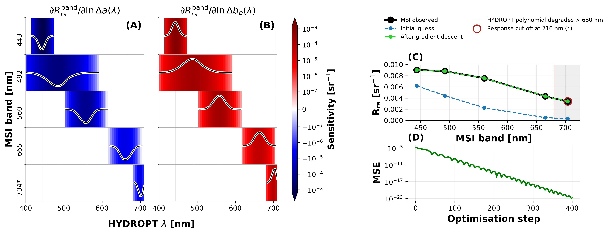

# D-HYDROPT

**Differentiable HYDROPT — gradient-based inversion of ocean colour observations, built on [JAX](https://github.com/jax-ml/jax).**

[](./LICENSE)

D-HYDROPT is an experimental fork of the [HYDROPT](https://github.com/tadz-io/hydropt)
radiative transfer framework. It reimplements HYDROPT's polynomial forward model in JAX so
that Jacobians ∂R<sub>rs</sub>/∂θ come from automatic differentiation rather than hand-written
derivatives, which makes sensitivity analysis and gradient-based retrieval straightforward.

The original NumPy implementation is retained in `hydropt/`, and a test suite pins the JAX
model to it: the two agree to 1e-10 relative on both the forward model and its gradient.

---

## Contents

- [Install](#install)
- [Quick start](#quick-start)
- [The validity domain — read this first](#the-validity-domain--read-this-first)
- [Satellite band integration](#satellite-band-integration)
- [Worked example](#worked-example)
- [What is in the box](#what-is-in-the-box)
- [Limitations](#limitations)
- [Citing HYDROPT](#citing-hydropt)
- [Licence](#licence)

---

## Install

Python 3.9 or newer.

```bash
git clone https://github.com/mowerther/D-HYDROPT.git
cd D-HYDROPT
pip install -e .
```

That pulls in NumPy, pandas, matplotlib, scikit-learn, xarray and JAX. For GPU or TPU
support, install the matching JAX wheel first — see the
[JAX installation guide](https://docs.jax.dev/en/latest/installation.html).

Run the tests:

```bash
pytest
```

`hydropt_jax` enables JAX's x64 mode when imported. This is deliberate and not optional in
practice: the polynomial is fitted in log space with coefficients reaching ~700, so float32
`exp()` underflows to exactly zero across the red end of the spectrum. Set
`HYDROPT_JAX_DISABLE_X64=1` if you need to override it.

---

## Quick start

```python
import jax.numpy as jnp
from hydropt_jax import load_pace_poly, load_water_iops, monomial_powers_2d, rrs_from_excess

# HYDROPT polynomial coefficients, on a 5 nm grid from 400 to 710 nm.
wavelength, coeffs = load_pace_poly()
powers = monomial_powers_2d(4)

# Pure water sets the physical floor on the IOPs. Parameterise what is on top of it.
a_water, bb_water = load_water_iops(wavelength)

log_excess_a = jnp.log(jnp.full(wavelength.shape, 0.05))    # m^-1 above pure water
log_excess_bb = jnp.log(jnp.full(wavelength.shape, 0.005))  # m^-1 above pure water

rrs = rrs_from_excess(log_excess_a, log_excess_bb, a_water, bb_water, coeffs, powers)
```

Gradients come from JAX directly — nothing special is required:

```python
import jax

def forward(state):
    return rrs_from_excess(state[0], state[1], a_water, bb_water, coeffs, powers)

state = jnp.stack([log_excess_a, log_excess_bb])

jacobian = jax.jacrev(forward)(state)   # (n_wavelengths, 2, n_wavelengths)
```

`jax.jit` and `jax.vmap` work on all of it. `rrs_poly_batched` is a ready-made `vmap` over
many states at once.

---

## The validity domain — read this first

HYDROPT approximates radiative transfer with a degree-4 polynomial in `log(a)` and
`log(bb)`. Like any polynomial fit it is only meaningful inside the region it was trained
on, and **evaluating it outside that region fails silently** — you get `exp()` of a large
negative number, which underflows to exactly zero in both the value *and its gradient*. An
optimiser handed those bands receives no signal and no error.

Two limits matter.

**1. Pure water is a floor.** No natural water body absorbs or backscatters less than pure
water: at 710 nm water alone absorbs 0.827 m⁻¹. Parameterise with `iops_from_excess()` and
this becomes impossible to violate, since `exp()` is positive for any input:

```python
from hydropt_jax import iops_from_excess

a, bb = iops_from_excess(log_excess_a, log_excess_bb, a_water, bb_water)
# a >= a_water and bb >= bb_water, for any finite state and any gradient step
```

**2. The coefficients degenerate past 680 nm.** The largest coefficient per wavelength sits
near 3.0 from 400 nm all the way to 685 nm, then climbs steeply:

| wavelength | 400–685 nm | 690 nm | 695 nm | 700 nm | 705 nm | 710 nm |
|---|---|---|---|---|---|---|
| max &#124;coefficient&#124; | ≈ 3 | 15 | 66 | 172 | 328 | 707 |
| max excess absorption before runaway | > 20 m⁻¹ | 1.6 | 0.86 | 0.62 | 0.56 | 0.51 |

So `RELIABLE_WAVELENGTH_RANGE` is `(400.0, 680.0)`: the range that holds for *any* plausible
optical state. Past it the model may still be fine — it depends on how absorbing the water
is — which is what `check_domain()` is for:

```python
from hydropt_jax import DomainError, check_domain, reliable_band_mask

# Collect problems without raising: returns [] if the state is fine.
problems = check_domain(a, bb, wavelength, coeffs, powers, error=False)

# Or restrict to the wavelengths that are safe whatever the state.
mask = reliable_band_mask(wavelength)                  # 57 of the 63 bands
check_domain(a[mask], bb[mask], wavelength[mask], coeffs[mask], powers)   # passes
```

By default it raises, and the message names what went wrong and where:

```python
try:
    check_domain(jnp.full(wavelength.shape, 0.05),     # below pure water in the red
                 jnp.full(wavelength.shape, 0.005),
                 wavelength, coeffs, powers)
except DomainError as error:
    print(error)
```

```text
state is outside the HYDROPT polynomial domain:
  - absorption is below pure water at 34 of 63 wavelengths (worst: a = 0.05 m^-1
    at 710 nm, where pure water alone is 0.827 m^-1). Parameterise with
    iops_from_excess() to prevent this.
  - 6 of 63 wavelengths lie outside the reliable range 400-680 nm (685, 690, 695,
    700, 705, 710). The degree-4 coefficients degenerate past 680 nm and Rrs
    underflows to exactly zero there.
  - the polynomial has run away at 6 of 63 wavelengths: log(Rrs) leaves [-30, 0]
    (worst: -401.5 at 690 nm, i.e. Rrs = 4.08e-175 sr^-1). This means the
    polynomial is extrapolating, not that the water is dark.
```

`check_domain()` is an eager check for use around an optimisation, not inside one — it
cannot run on traced values under `jit` or `grad`. Inside the loop, use
`iops_from_excess()` so the failure cannot arise.

---

## Satellite band integration

```python
import numpy as np
from hydropt_jax import build_gaussian_srf, classify_bands, msi_sigma_nm

band_wl = np.array([443, 492, 560, 665, 704, 740, 780])
sigma = msi_sigma_nm(band_wl)                      # from published MSI FWHM
srf = build_gaussian_srf(wavelength, band_wl, sigma)

rrs_bands = rrs @ srf.T
```

**Check the band coverage before trusting the result.** `build_gaussian_srf` normalises each
row over the coefficient grid, so a band lying mostly *outside* 400–710 nm still produces a
confident-looking number — it is simply the reflectance at the grid's red end wearing that
band's label. For Sentinel-2 MSI:

| band | response inside 400–710 nm | verdict |
|---|---|---|
| 443, 492, 560, 665 nm | ≥ 99.9 % | usable |
| 704 nm | 82.7 % | usable, with a truncation bias |
| 740 nm | 0.0001 % | **not a measurement** — this is R<sub>rs</sub>(710) |
| 783 nm | 0.0000 % | **not a measurement** — this is R<sub>rs</sub>(710) |

The 740 and 783 nm rows correlate at 0.99993 with each other, because both are the same
delta function at 710 nm. `classify_bands()` reports these figures and sorts bands into
`full`, `clipped` and `unusable`.

---

## Worked example

```bash
python examples/msi_gradient_inversion.py
```

Loads Sentinel-2 MSI reflectance, classifies the bands, computes Jacobian statistics over an
ensemble of optical states, inverts one pixel by gradient descent, and writes
`examples/figures/msi_gradient_inversion.png`.



**(A, B)** median ∂R<sub>rs</sub><sup>band</sup>/∂ln a and ∂R<sub>rs</sub><sup>band</sup>/∂ln b<sub>b</sub>
across the ensemble, on a symmetric-log colour axis — sensitivity spans two orders of
magnitude from the blue bands to the red. **(C)** the observed spectrum, the starting guess
and the fit; the ringed point is the 704 nm band, whose response the coefficient grid cuts
short. **(D)** convergence.

Useful flags: `--select {best,worst,median,improve,index}` picks which pixel to display,
`--gd-steps` and `--gd-lr` control the optimiser, `--msi-csv` points at your own data.
Run with `--help` for the rest.

Note that the inversion is deliberately under-determined — two free parameters at each of 63
wavelengths against five usable bands — so the fit it reaches is one of infinitely many that
reproduce the observations. It demonstrates the gradient machinery, not a well-posed
retrieval. For that, reduce the state to a few bio-optical parameters, as `hydropt.bio_optics`
does.

---

## What is in the box

```
hydropt/            Original HYDROPT (NumPy/lmfit), retained as the reference implementation
  data/             Polynomial coefficients, pure water IOPs, phytoplankton SIOPs
  hydropt.py        BioOpticalModel, PolynomialReflectance, InversionModel
  bio_optics.py     IOP models for water, phytoplankton, NAP, CDOM
hydropt_jax/        Differentiable implementation
  core.py           Polynomial features and the rrs_poly kernel
  data.py           Coefficient tables and pure water IOPs
  domain.py         Water floor, validity checks, reliable wavelength range
  bands.py          Spectral response functions and band coverage classification
examples/           Worked example and sample data
tests/              Unit tests, plus JAX-vs-NumPy equivalence and domain guards
```

`rrs_poly` is deliberately a bare kernel with no validation, so it stays traceable under
`jit`, `grad` and `vmap`. Everything that needs to branch on values lives in
`hydropt_jax.domain`.

---

## Limitations

- **Geometry** — nadir view, 30° solar zenith angle only. The coefficients encode it.
- **Wavelengths** — coefficients are tabulated 400–710 nm at 5 nm; only 400–680 nm is
  reliable for arbitrary optical states.
- **Approximation** — a polynomial fit to full radiative transfer. See the papers below for
  its accuracy.
- **Degree-5 table** — `PACE_polynom_05.csv` ships and is reachable via `load_pace_poly(5)`,
  but it is a separate fit that is *not* validated against the reference implementation.
  Treat it as experimental.
- **Experimental** — this is research code and the API may change.

---

## Citing HYDROPT

D-HYDROPT builds on HYDROPT, developed by Van Der Woerd & Pasterkamp (2008) and
Holtrop & Van Der Woerd (2021). Please cite the original work:

> Holtrop, T., & Van Der Woerd, H. J. (**2021**). HYDROPT: An Open-Source Framework for Fast
> Inverse Modelling of Multi- and Hyperspectral Observations from Oceans, Coastal and Inland
> Waters. *Remote Sensing*, 13(15), 3006.
> [doi:10.3390/rs13153006](https://www.mdpi.com/2072-4292/13/15/3006)

> Van Der Woerd, H. J., & Pasterkamp, R. (**2008**). HYDROPT: A fast and flexible method to
> retrieve chlorophyll-a from multispectral satellite observations of optically complex
> coastal waters. *Remote Sensing of Environment*, 112, 1795–1807.
> [doi:10.1016/j.rse.2007.09.001](https://www.sciencedirect.com/science/article/abs/pii/S003442570700421X)

```bibtex
@article{Holtrop_2021,
    title={HYDROPT: An Open-Source Framework for Fast Inverse Modelling of Multi- and
           Hyperspectral Observations from Oceans, Coastal and Inland Waters},
    author={Holtrop, Tadzio and Van Der Woerd, Hendrik Jan},
    journal={Remote Sensing},
    volume={13}, number={15}, pages={3006}, month={Jul}, year={2021},
    DOI={10.3390/rs13153006}, publisher={MDPI AG}
}
```

---

## Licence

[AGPL-3.0](./LICENSE)

## Acknowledgements

This implementation by Mortimer Werther extends the original HYDROPT framework. Thanks to
Tadzio Holtrop and Hendrik Jan van der Woerd for developing and openly sharing HYDROPT.
